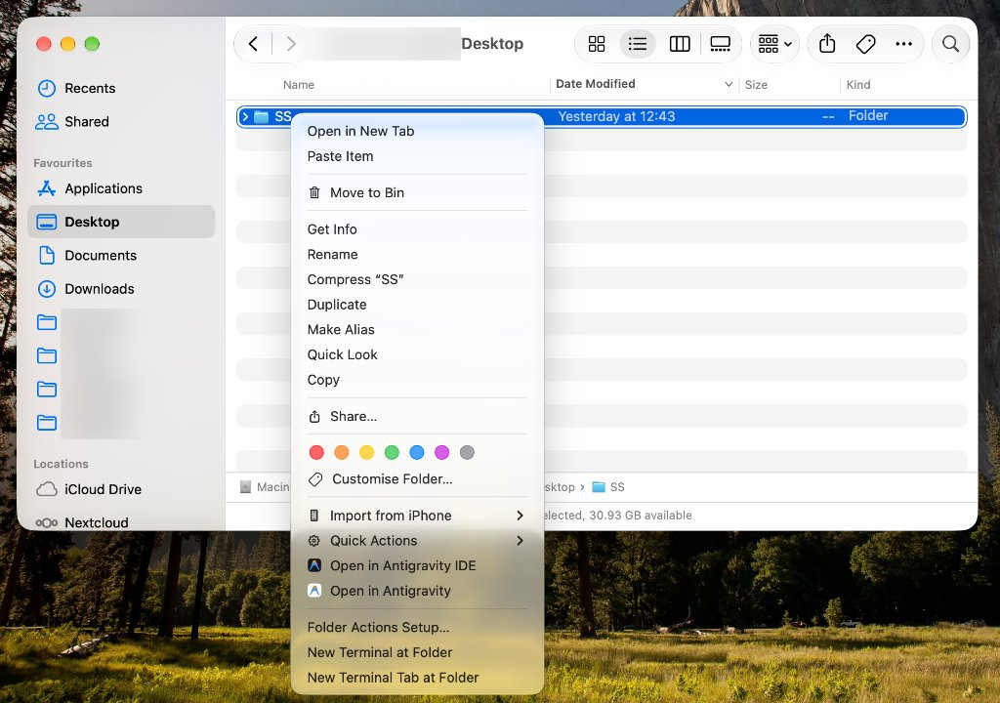

# Open in Antigravity

[](https://github.com/muradjabir/open-in-antigravity/actions/workflows/ci.yml)


A lightweight native macOS Finder Sync Extension (`FIFinderSync`) bundled inside an invisible background helper app that puts **Open in Antigravity IDE** and **Open in Antigravity** at the top level of Finder's right-click context menu.



## Features

- **Top-level Finder context menu**: Appears directly in Finder's right-click menu—no hunting inside submenus.
- **Automatic app detection**: Shows **Open in Antigravity IDE** and/or **Open in Antigravity** based on which bundles exist in `/Applications/`.
- **Works everywhere you right-click**: Supports files, folders, multi-selection, sidebar items, and empty space inside an open Finder folder.
- **Universal macOS binary**: Compiles natively for both Apple Silicon (`arm64`) and Intel (`x86_64`) Macs (macOS 13+).
- **Zero background bloat**: The helper app runs with `LSUIElement = true` (no Dock icon or menu bar item) and exits cleanly right after launching the target app.

## Installation

### Recommended — Build from Source

Building locally avoids macOS Gatekeeper quarantine prompts on ad-hoc signed downloads and requires only Xcode Command Line Tools (`xcode-select --install`):

```bash
git clone https://github.com/muradjabir/open-in-antigravity.git
cd open-in-antigravity
make install
```

> **Note:** During compilation, `scripts/build.sh` copies icons from `/Applications/Antigravity IDE.app` and `/Applications/Antigravity.app` if installed on your Mac.

### Prebuilt GitHub Release (Gatekeeper Note)

Prebuilt `.zip` downloads on the [Releases](https://github.com/muradjabir/open-in-antigravity/releases) page are ad-hoc signed (not notarized with an Apple Developer ID). If macOS Gatekeeper blocks the downloaded app after moving `OpenInAntigravity.app` to `/Applications/`, clear the quarantine attribute and register the extension:

```bash
xattr -cr /Applications/OpenInAntigravity.app
open -g /Applications/OpenInAntigravity.app
pluginkit -a /Applications/OpenInAntigravity.app/Contents/PlugIns/AntigravityFinderSync.appex
pluginkit -e use -i io.github.muradjabir.open-in-antigravity.findersync
```

## Uninstall

```bash
make uninstall
```

Or run `./scripts/uninstall.sh` directly. This disables and unregisters the Finder Sync extension via `pluginkit`, removes the LaunchServices entry, and deletes `/Applications/OpenInAntigravity.app`.

## How It Works

macOS requires Finder Sync extensions (`FIFinderSync`) to run inside the App Sandbox, which prevents the extension from directly launching external unsandboxed apps cleanly. This project bridges that boundary with two minimal binaries:

- **Sandboxed Finder Sync Extension (`AntigravityFinderSync.appex`)**: Renders the top-level Finder context menu items and, when clicked, opens an `antigravity-opener://open?target=...&path=...` URL via `NSWorkspace`.
- **Unsandboxed Host Helper App (`OpenInAntigravity.app`)**: Registers the `antigravity-opener://` URL scheme with `LSUIElement = true`, validates that the requested target app and path exist, launches Antigravity via `/usr/bin/open -a`, and exits immediately.

## Known Limitations & Troubleshooting

- **iCloud Drive & Cloud-Synced Folders**: On macOS, Apple's CloudDocs/FileProvider menu provider suppresses third-party Finder Sync menu items inside iCloud-synced folders (such as iCloud Desktop & Documents, Google Drive, or OneDrive). For those locations, create an Automator Quick Action / Service under **System Services** as a fallback.
- **Menu items not appearing immediately**:
  - Restart Finder: `killall Finder`
  - Confirm the extension is enabled in **System Settings → General → Login Items & Extensions → File Providers** (or **System Settings → Privacy & Security → Extensions → Finder Extensions** on older macOS).
  - Verify registration status in Terminal:
    ```bash
    pluginkit -m -v -i io.github.muradjabir.open-in-antigravity.findersync
    ```
    An enabled extension displays a `+` prefix.

## License

[MIT](LICENSE)
